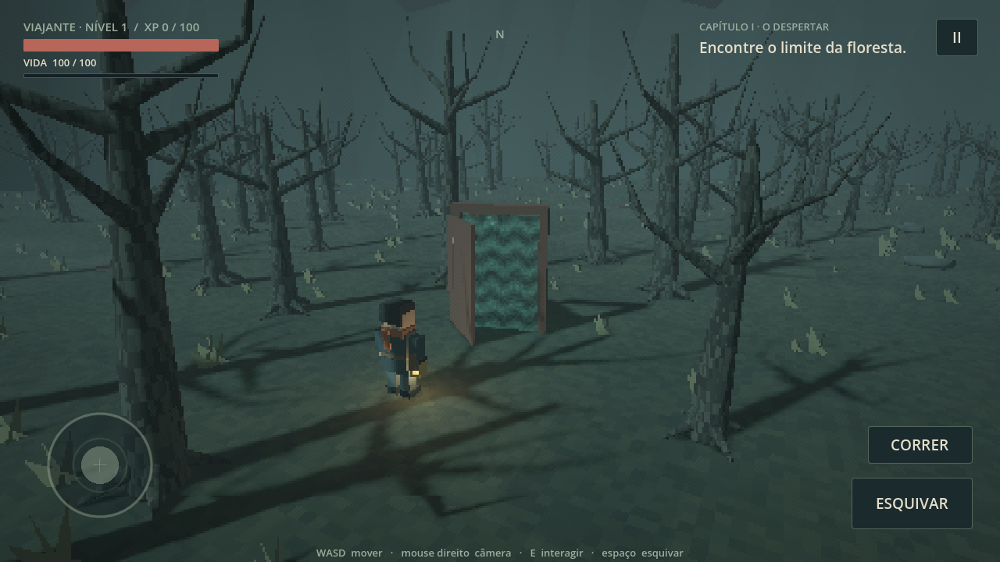

# The Last Linea

**Um homem sem memória. Uma floresta que devolve seus passos. Uma montanha no fim de qualquer caminho.**

RPG narrativo em capítulos para Android, com mundo 3D, resolução pixelada e interface em português.
Criação: **Emanuel Bonfim / B5 Soluções**.

[**Baixar o APK mais recente**](https://github.com/emanoelb5-lgtm/the-last-Linea/releases/latest/download/TheLastLinea.apk) · [Releases](https://github.com/emanoelb5-lgtm/the-last-Linea/releases) · [Compilações no Actions](https://github.com/emanoelb5-lgtm/the-last-Linea/actions/workflows/android.yml)



[Ver a abertura](docs/screenshots/02-abertura.webp) · [Ver a exploração](docs/screenshots/03-exploracao.webp)

## Capítulo I — A floresta que devolve

- Abertura com câmera animada: árvores secas, névoa e um homem desacordado que desperta.
- Pequeno mundo aberto com 240 árvores marcáveis, pedras de memória, clareira de descanso e montanhas em todo o perímetro.
- Riscos nas árvores persistem entre retornos, mortes e sessões. Cada árvore concede XP apenas uma vez.
- Quatro portas isoladas fazem o personagem voltar à clareira ao cruzar seus vãos; pistas e experiência permanecem.
- Quatorze armadilhas sinalizadas por placas de metal. É possível evitá-las, esquivar ou desarmá-las pela borda.
- Vida, experiência, níveis e recuperação de vida ao subir de nível. **Sem barra de fome.**
- A montanha é descoberta em qualquer direção. Uma fenda aparece no trecho encontrado e encerra o capítulo com um gancho para a continuação.
- Três memórias opcionais e caderno para reler as descobertas.
- Salvamento local automático e configurações de áudio, câmera, tamanho do joystick, qualidade visual, 30/60 FPS e contador de FPS.

## Jogar

Android 7 ou posterior, **ARM64** e OpenGL ES 3.0. O Galaxy A56 pertence à arquitetura atendida; desempenho precisa ser medido em um aparelho real.

| Ação | Celular | PC / controle Bluetooth |
|---|---|---|
| Mover | Arrastar no lado esquerdo | WASD / setas / analógico esquerdo |
| Olhar | Arrastar no lado direito | Mouse direito + arrastar / Q e R / analógico direito |
| Interagir | Botão contextual | E / A |
| Esquivar | Botão Esquivar | Espaço / B |
| Correr | Botão Correr / Andar | Shift ou botão de tela |
| Pausar | Botão II / voltar do Android | Esc / Start |

Instale o APK da release. O Android pede autorização para instalar de uma fonte externa. Depois, abra **Configurações e atualizações → Buscar atualização** dentro do jogo. O progresso fica no aparelho e é preservado ao atualizar o mesmo pacote, sem desinstalar.

## Engine e direção visual

Godot **4.6.3**, GDScript e renderer **Compatibility**. Cenário, personagens, colisões e câmera são 3D reais, renderizados em 180p, 270p ou 360p e ampliados por vizinho mais próximo; interface em resolução independente. Há quantização de cor e dithering leve. Árvores e vegetação usam MultiMesh, névoa de profundidade e planos leves de bruma. Sem névoa volumétrica dependente de Vulkan. Modelos, shaders e áudio sintetizado são originais do projeto.

## Desenvolvimento e Actions

Abra `project.godot` no Godot 4.6.3. Não exige licença de engine, servidor, conta de jogador ou assets pagos.

```bash
python3 tools/run_checks.py
```

O workflow `Android · capítulo I` roda em pushes para `main`, pull requests e execução manual. Ele:

1. Importa o projeto e executa testes de movimento, história, portas, armadilhas, persistência e validação do atualizador.
2. Instala SDK Android, templates da mesma versão do Godot e compila a ponte nativa de instalação.
3. Gera o APK ARM64 com código de versão crescente (`1000 + github.run_number`).
4. Verifica assinatura e publica o APK, manifesto de atualização e SHA-256 como release nos pushes para `main`.
5. Mantém os arquivos e logs como artefatos do Actions. Pull requests não publicam releases.

O atualizador consulta apenas este repositório público, cruza nome/URL/tamanho com os assets da release, confere SHA-256 após o download e entrega um `content://` privado ao instalador do Android. Nenhum token é incluído no aplicativo. Downloads parciais não são instalados e falhas de rede não interrompem a história.

### Assinatura desta prévia

O pacote **`online.b5solucoes.thelastlinea.preview`** é exclusivamente de teste. O arquivo `tools/preview-signing.base64` contém deliberadamente uma identidade Android **DEBUG pública**, sem credenciais pessoais. Sua finalidade é permitir atualizar esta prévia entre compilações reproduzíveis sem segredos de produção. Não use essa chave para publicação na Play Store ou para uma edição de produção. A edição de produção deverá ter outro ID de pacote e chave privada armazenada em GitHub Secrets, sem colocar a chave no código público.

## Próximos capítulos

A primeira versão estabelece exploração, progressão, persistência e distribuição. O próximo capítulo pode acrescentar o outro lado da fenda, novos personagens, diálogos e combate. Veja [docs/CHAPTERS.md](docs/CHAPTERS.md) para a continuidade e os pontos de extensão.
